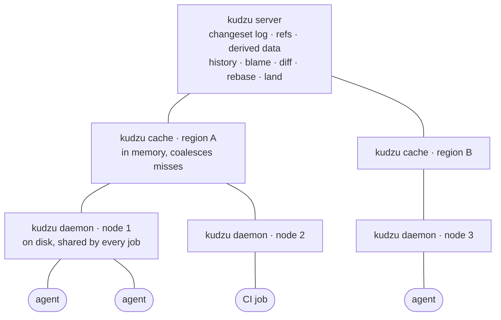
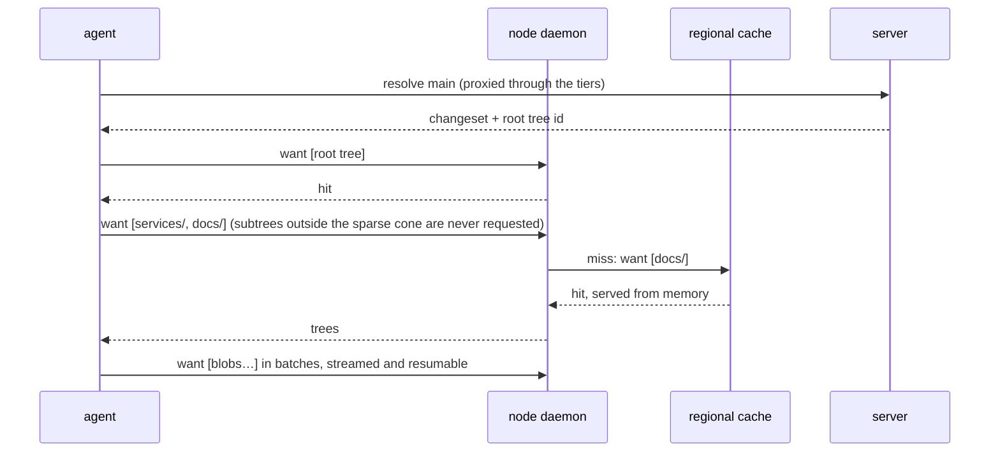
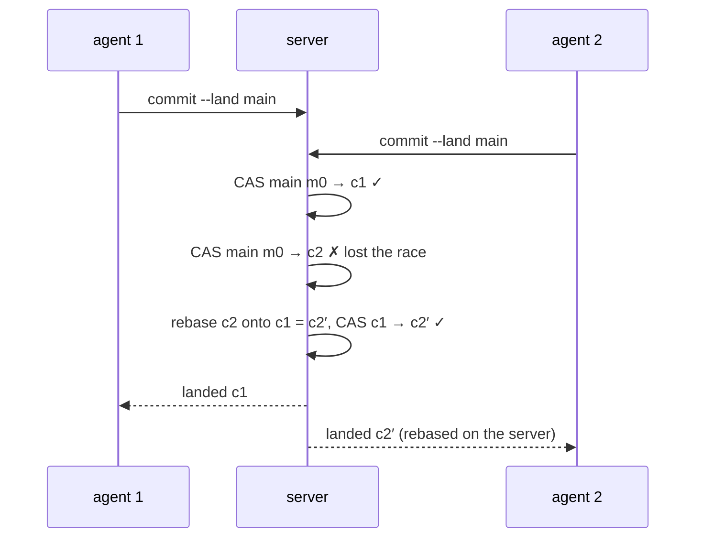

<div align="center">


# Kudzu

### Anthropic's monorepo outgrew git at 30,000+ merges a day, so they built Scion and kept it internal.<br/>Kudzu is the open-source rebuild.

Version control for monorepos where your committers are AI agents.<br/>
Rebuilt from Anthropic's [engineering post](https://www.anthropic.com/engineering/redesigning-source-control) the day after it was published.<br/>
*Your agents write code like kudzu grows. Your version control should keep up.*

[](https://github.com/garyships/kudzu/releases)
[](https://github.com/garyships/kudzu/actions/workflows/ci.yml)
[](docs/AI.md)
[](LICENSE)


[**Website**](https://garyships.github.io/kudzu/) · [**Demo video**](https://garyships.github.io/kudzu/#demo) · [Design](docs/DESIGN.md) · [For AI agents](docs/AI.md) · [中文](README.zh-CN.md)


<sub>⭐ If you want agent-scale version control built in the open, star the repo. It's how other people find it.</sub>

</div>

## Try it in 60 seconds

```bash
curl -fsSL https://raw.githubusercontent.com/garyships/kudzu/main/install.sh | sh
cd any-git-repo && kudzu up      # imports the history, runs server → cache → daemon
```

Then, in another terminal:

```bash
export KUDZU_REMOTE=unix:///tmp/kudzu.sock
kudzu log -n 5 --oneline                          # history without a checkout
kudzu blame README.md                             # computed on the server
kudzu clone --sparse src $KUDZU_REMOTE /tmp/wc    # fetches only src/
```

With Go: `go install github.com/garyships/kudzu/cmd/kudzu@latest`. Windows builds are on the [releases page](https://github.com/garyships/kudzu/releases).

## 🤖 Version control your agent can drive

Kudzu speaks MCP. One line connects Claude Code, and any other MCP client works the same way:

```bash
claude mcp add kudzu -e KUDZU_REMOTE=unix:///tmp/kudzu.sock -- kudzu mcp
```

Then just ask:

> *"Who last changed the retry logic in `services/api/handler.go`, and what else did that changeset touch?"*<br/>
> *"What landed under `services/api` today?"*<br/>
> *"Bump the version in `VERSION` and land it on main."* No checkout and no push: the server rebases and lands it.

| 11 read tools | 5 write tools |
|---|---|
| `kudzu_log` `kudzu_blame` `kudzu_diff` `kudzu_cat` `kudzu_ls` `kudzu_show` `kudzu_resolve` `kudzu_ancestry` `kudzu_refs` `kudzu_stats` `kudzu_wc_status` | `kudzu_write` (files in, landed changeset out) `kudzu_land` `kudzu_rebase` `kudzu_wc_commit` `kudzu_wc_update` |

- `--read-only` hides the write tools.
- Agents with a shell can use the [Agent Skill](skills/kudzu/SKILL.md) instead.
- Every query and commit command takes `--json`.

Setup for Cursor, Claude Desktop and other clients: [docs/AI.md](docs/AI.md). There is also [`llms.txt`](https://garyships.github.io/kudzu/llms.txt) for LLMs.

## Why not git?

git gives every clone the whole repository so it can work offline. That's the wrong trade when nearly every client is an always-online agent and a monorepo merges tens of thousands of changes a day. Kudzu moves the heavy lifting to the server and lets clients fetch only what they need.

| | git | Kudzu |
|---|---|---|
| **Clone** | full history to every client | only the trees and blobs you ask for, sparse by default |
| **History, blame, diff** | computed from your local clone | server API, no checkout needed |
| **Commit** | commit locally, then push | the server creates the changeset; nothing to push |
| **Landing** | merge queue, global lock | lock-free: server-side rebase plus compare-and-swap on the ref |
| **Scaling reads** | mirrors that each hold the whole repo | tiers of caches for immutable objects |
| **Maintenance** | repack and gc on every replica | none: no packfiles |
| **Offline** | ✅ fully | ❌ needs the server, by design |
| **Storage** | delta-compressed packs (smaller) | one object per blob, no deltas (larger) |

## How it works



Every tier answers the **same object RPCs**, so clients never need to know the topology. Objects are content-addressed and immutable, so any tier can serve any request.

**Clone = ask for what you want, never say what you have.**



**Landing never takes a lock.**



Changesets record only what changed. Root trees, per-path history, a commit-graph skip list and blame are **derived data** that one recursive engine computes, eagerly or lazily. See [docs/DESIGN.md](docs/DESIGN.md) for the details.

## Run the tiers separately

`kudzu up` runs all three tiers in one process. In production each tier runs on its own: one server, a cache per region, a daemon per machine.

<details>
<summary>Server, regional cache and node daemon as separate processes</summary>

```bash
# import an existing git repo (re-run any time; only new commits are ingested)
kudzu import --store ./data --git /path/to/repo --as main

kudzu server --store ./data --listen 127.0.0.1:7070 &
kudzu cache  --upstream 127.0.0.1:7070 --listen 127.0.0.1:7071 &
kudzu daemon --upstream 127.0.0.1:7071 --listen unix:///tmp/kudzu.sock &
export KUDZU_REMOTE=unix:///tmp/kudzu.sock

# sparse clone, edit, land
kudzu clone --sparse services/api $KUDZU_REMOTE wc && cd wc
echo "// hi" >> services/api/handler.go
kudzu commit -m "api: say hi" --land main

# or skip the checkout entirely
kudzu write -r main -m "bump version" --land main VERSION=@./VERSION
```

`scripts/demo.sh /path/to/git/repo` runs the whole flow end to end and prints each tier's cache statistics.

</details>

## Numbers

These come from importing the last 529 commits (3,613 files) of a real repo, with every tier on one machine. They are illustrative, not a benchmark.

| | time |
|---|---|
| import 529 git commits, with all derived data | ~5 s |
| sparse clone of `src/` (1,838 files), cold daemon | 0.30 s |
| full clone, warm daemon | 0.46 s |
| full clone on a second machine, warm regional cache | 0.49 s |
| `git clone --no-local` of the same repo | 2.07 s |
| 50 simultaneous cold requests for the same objects | 1 upstream request |

The trade-off: with no packfiles or deltas, server storage was 79 MB, against 26 MB for git's packfile.

## Status

Kudzu is a working prototype with a test suite: `go test -race ./...`. Imports are checked against `git ls-tree` and `git blame --first-parent`. Not built yet:
- virtualized (FUSE) checkouts
- auth and per-directory ACLs
- a shared multi-server backend (Postgres or Spanner, S3)
- object GC
- export back to git

Contributions are welcome. Pick up a [help-wanted issue](https://github.com/garyships/kudzu/issues?q=is%3Aissue+is%3Aopen+label%3A%22help+wanted%22), and see [AGENTS.md](AGENTS.md) for a map of the code.

## License

MIT. Kudzu is an unofficial rebuild of the system described in Anthropic's public post [Redesigning source control at Anthropic](https://www.anthropic.com/engineering/redesigning-source-control). It is not affiliated with or endorsed by Anthropic and contains no Anthropic code.

---

<div align="center">

[](https://star-history.com/#garyships/kudzu&Date)

</div>
