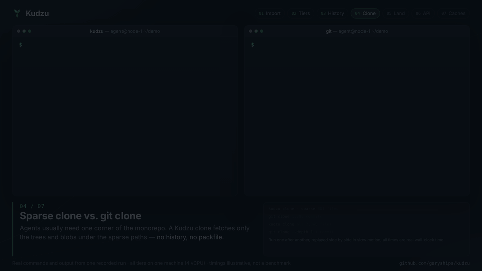

<div align="center">

# Kudzu

### Anthropic 每天合并 3 万多次代码，git 扛不住，于是他们自研了 Scion，但没有开源。<br/>Kudzu 是照着他们的文章复刻的开源版。

为"提交代码的主要是 AI agent"的 monorepo 设计的版本控制系统。<br/>
在 Anthropic 发布[这篇工程文章](https://www.anthropic.com/engineering/redesigning-source-control)的第二天复刻完成。<br/>
*你的 agent 写代码像葛藤一样疯长，版本控制得跟得上。*

[官网](https://garyships.github.io/kudzu/) · [演示视频](https://garyships.github.io/kudzu/#demo) · [设计文档](docs/DESIGN.zh-CN.md) · [给 AI agent 用](docs/AI.md) · [English](README.md)



</div>

## 为什么不用 git？

git 让每个 clone 都拿到完整仓库，好处是能离线工作。可是当几乎所有客户端都是永远在线的 agent、monorepo 每天要合并几万次时，这个设计就不划算了。Kudzu 把重活交给服务端，客户端只拉自己需要的东西。

| | git | Kudzu |
|---|---|---|
| **clone** | 每个客户端都拿完整历史 | 只拉你要的 tree 和 blob，默认就是 sparse |
| **历史、blame、diff** | 在本地 clone 上计算 | 服务端 API，不需要 checkout |
| **提交** | 本地 commit，再 push | 服务端直接创建 changeset，没有 push 这一步 |
| **合并进主干** | merge queue，全局锁 | 无锁：服务端 rebase，再对 ref 做 CAS |
| **读扩展** | 很多 mirror，每个都存整个仓库 | 多层缓存，缓存的都是不可变对象 |
| **维护** | 每个副本都要 repack 和 gc | 不需要，因为没有 packfile |
| **离线** | ✅ 完全支持 | ❌ 必须连服务端，这是刻意的设计 |
| **存储** | delta 压缩的 pack，体积更小 | 每个 blob 单独存，没有 delta，体积更大 |

架构图和流程图见 [英文 README](README.md#how-it-works)，或者 [官网](https://garyships.github.io/kudzu/) 上的动画。

## 快速上手

```bash
go install github.com/garyships/kudzu/cmd/kudzu@latest

kudzu import --store ./data --git /path/to/repo --as main     # 导入 git 历史，可以重复执行

kudzu server --store ./data --listen 127.0.0.1:7070 &
kudzu cache  --upstream 127.0.0.1:7070 --listen 127.0.0.1:7071 &
kudzu daemon --upstream 127.0.0.1:7071 --listen unix:///tmp/kudzu.sock &
export KUDZU_REMOTE=unix:///tmp/kudzu.sock

kudzu log -n 5 --oneline                  # 不用 checkout 就能查历史
kudzu blame src/server.go
kudzu clone --sparse services/api $KUDZU_REMOTE wc && cd wc
kudzu commit -m "api: tweak" --land main  # 在服务端创建 changeset 并合进主干
kudzu write -r main -m "bump" --land main VERSION=@./VERSION   # 完全不用工作区
```

## 给 AI agent 用

agent 有三种方式使用 Kudzu：

- **MCP server**：`kudzu mcp` 提供 16 个工具，包括 log、blame、diff、cat，以及不需要工作区的写入 + land。加 `--read-only` 会隐藏所有写操作工具。
- **Agent Skill**：[`skills/kudzu`](skills/kudzu/SKILL.md) 教 agent 理解 Kudzu 的工作方式（没有 push、用 land 代替 merge、遇到 409 冲突怎么办）和常见用法。
- **`--json`**：所有查询和提交命令都支持，方便脚本解析。

```bash
claude mcp add kudzu -e KUDZU_REMOTE=unix:///tmp/kudzu.sock -- kudzu mcp   # Claude Code，其他客户端见 docs/AI.md
cp -r skills/kudzu ~/.claude/skills/                                        # 能用 shell 的 agent 装 skill
```

## 实测数据

测试对象是一个真实仓库最近的 529 个提交（3613 个文件），所有层都跑在同一台机器上，只看量级，不是严格的 benchmark：
- 导入耗时约 5 秒
- sparse clone（冷 daemon）0.30 秒
- 全量 clone（daemon 已经缓存过）0.46 秒
- 另一台机器的全量 clone（区域缓存已经缓存过）0.49 秒
- 对照：同一个仓库 `git clone` 要 2.07 秒

代价是存储更大：服务端占 79 MB，git 的 packfile 只有 26 MB。

## 现状

Kudzu 是一个可以运行的原型，测试用 `go test -race ./...`。导入结果和 `git ls-tree`、`git blame --first-parent` 逐一核对过。还没做：
- 虚拟化 checkout（FUSE）
- 认证和按目录的权限控制
- 多台服务端共享后端（Postgres 或 Spanner，S3）
- 对象回收
- 导出回 git

## 许可证

MIT。Kudzu 是对 Anthropic 公开文章 [Redesigning source control at Anthropic](https://www.anthropic.com/engineering/redesigning-source-control) 所描述系统的非官方复刻，和 Anthropic 没有关系，也没有得到 Anthropic 的背书，不包含 Anthropic 的任何代码。
